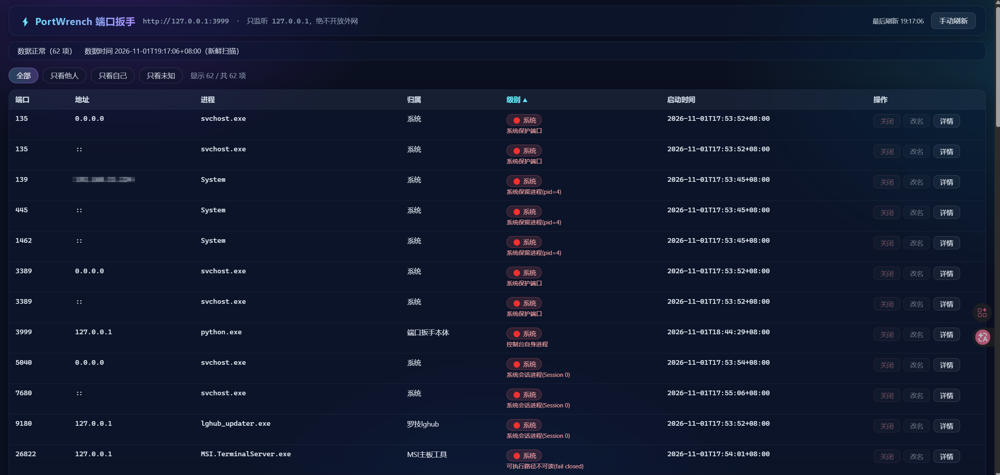
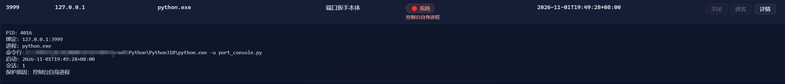

<p align="center"></p>

English · [中文](README.md)

<p align="center"><code>MIT License</code> &nbsp;·&nbsp; <code>Python 3.10+</code> &nbsp;·&nbsp; <code>Windows only</code> &nbsp;·&nbsp; <code>Zero third-party dependencies</code> &nbsp;·&nbsp; <code>Loopback only (127.0.0.1)</code></p>

# PortWrench

This is the English translation of README.md. If there is any inconsistency, the Chinese version prevails.

> **Starting today, just say one sentence and let AI operate ports for you.**
>
> **PortWrench** makes it easier for AI to manage your ports and greatly reduces the risk of killing the wrong process. It improves accuracy while saving time and tokens.

---


```
You  ▸ Close port 3000
AI   ▸ Done.

C:\> netstat -ano | findstr :3000
  TCP    127.0.0.1:3000    LISTENING    12345

You  ▸ ……
```

---

**"Give these hands a boundary, and you give them the confidence to do this well."**

Helping AI see the boundaries of a task quickly is the first step in getting your work done.  
A tool that can be used often must not only be handy; more importantly, it must be safe.

> **Workflow followed across this project's versions**: Project brief → proposal drafting → two-sided blind diff → independent third-party cross-diff → implementation → code review → real-machine testing

---

## Contents

- [Interface at a glance](#interface-at-a-glance)
- [Design Intent](#design-intent)
  - [🎯 Designed for people, and for AI too](#-designed-for-people-and-for-ai-too)
  - [🛡️ Before acting, confirm it is still the same one](#️-before-acting-confirm-it-is-still-the-same-one)
  - [🗣️ It speaks plainly](#️-it-speaks-plainly)
  - [🚫 Things it refuses to do](#-things-it-refuses-to-do)
  - [📋 Every operation leaves an audit log](#-every-operation-leaves-an-audit-log)
  - [⚡ Zero dependencies](#-zero-dependencies)
- [What it is not](#what-it-is-not)
- [Installation and Running](#installation-and-running)
  - [Option 1: Launch by double-click (simplest)](#option-1-launch-by-double-click-simplest)
  - [Option 2: Launch from the command line](#option-2-launch-from-the-command-line)
  - [For AI: `portctl.py`](#for-ai-portctlpy)
- [Privacy](#privacy)
- [Usage and Safety Notes](#usage-and-safety-notes)
- [1. Run identity (one of the safety boundaries)](#1-run-identity-one-of-the-safety-boundaries)
- [2. Closing capability and two confirmations](#2-closing-capability-and-two-confirmations)
- [3. Protection rules (nobody may kill these)](#3-protection-rules-nobody-may-kill-these)
- [4. token and credential security](#4-token-and-credential-security)
- [5. L1 threat model boundary (must read)](#5-l1-threat-model-boundary-must-read)
  - [5.1 Display cache and manual refresh](#51-display-cache-and-manual-refresh)
- [6. AI access (AI: read this)](#6-ai-access-ai-read-this)
  - [6.1 Address discovery](#61-address-discovery)
  - [6.2 Read-only queries (L0, no token)](#62-read-only-queries-l0-no-token)
  - [6.3 Closing: the fixed rule "check first, then kill"](#63-closing-the-fixed-rule-check-first-then-kill)
  - [6.4 Caller tag](#64-caller-tag)
  - [6.5 Rules for reading the port reference tables](#65-rules-for-reading-the-port-reference-tables)
- [7. Audit log (written to disk only, no history UI)](#7-audit-log-written-to-disk-only-no-history-ui)
- [8. Configuration maintenance (restart the console after changes)](#8-configuration-maintenance-restart-the-console-after-changes)
- [9. FAQ](#9-faq)
- [Directory structure (release build)](#directory-structure-release-build)

---

## Interface at a glance

<p align="center">
  <br>
  <sub>Every listener: port · address · process · owner · tier · start time · actions. Red "System" rows are protected targets with the button disabled.</sub>
</p>

<p align="center">
  <br>
  <sub>Detail view: the command line is redacted for this machine, and when a target cannot be closed the <code>protection reason</code> is spelled out—it is a boundary, not a failure.</sub>
</p>

---

## Design Intent

### 🎯 Designed for people, and for AI too

AI: one API, one tool, one skill  
Operator: a clearer interface for managing ports and more convenient port control

```bash
python portctl.py find 3092     # → 3092 belongs to ComfyUI, closable
python portctl.py kill 3092     # → closed, port released
```

**AI does not need to understand PIDs, guess whose process it is, or dig through dozens of lines of `netstat` output.**

**PortWrench** comes with names for some known ports and lets you freely edit port information.

### 🛡️ Before acting, confirm it is still the same one

This is where the whole design begins.

**Other tools ask: can this process be killed?**  
**This tool asks: how do I know it is still the same one?**

A few hundred milliseconds pass between completing a scan and taking action. During that time, the target may exit on its own, or **the system may reuse its PID for another process**. You confirm the action—and end up killing someone else.

Before acting, the tool performs three checks: **Is the process handle still valid? · Can the process be opened? · Does its creation time still match?**  
If any check fails, **the action is refused**. The tool also distinguishes between "the target exited on its own" and "the target was replaced"—these require completely different handling.

### 🗣️ It speaks plainly

It does not hand you a string of PIDs to guess from:

```
3092   node.exe            ComfyUI              🟢 closable
9010   lghub_agent.exe     Logitech lghub       🟢 closable
9180   lghub_updater.exe   system service       🔴 protected
60799  node.exe            WorkBuddy service    🟢 closable
```

**The same Logitech software can be closed as a user process while its service remains protected—and PortWrench can tell the difference.**

### 🚫 Things it refuses to do

- **No one-click kill-all** (`Kill All` is a common way to trigger a blue screen)
- **No bulk cleanup by process name**
- **No touching processes that do not own a listening port**
- **No acting on something just because it "looks like" the target**

**It would rather tell you "I cannot close this one" than take a gamble.**

### 📋 Every operation leaves an audit log

`kill_audit.jsonl` records who made each request, when it happened, the target, whether its fingerprint matched, and the result.  
**When something goes wrong you can trace it, instead of relying on memory.**

### ⚡ Zero dependencies

Python 3.10+ standard library. **No packages to install, no external network access, no registry writes, and no startup tasks.**

---

## What it is not

Honesty matters more than selling points, so let's be clear:

| It does not                      | Notes                                                                                                      |
| -------------------------------- | ---------------------------------------------------------------------------------------------------------- |
| **Does not make closing faster** | Closing still takes a few seconds. What gets faster is "seeing" (1.4s → 19ms), not "killing"               |
| **Is not cross-platform**        | Windows only                                                                                               |
| **Is not cross-machine**         | Listens only on `127.0.0.1`; it cannot manage other computers                                              |
| **Does not identify everything** | It recognizes common software and labels the rest "Unknown"—**it does not guess**                          |
| **Is not a multi-user tool**     | Designed for a single user on a local machine. If this machine has a second Windows account, see Section 5 |

---

## Installation and Running

**No installation required.** Download, extract, and double-click—three steps.

### Option 1: Launch by double-click (simplest)

1. Download the release package (the zip from GitHub Releases) and unzip it to any directory
2. Double-click `启动端口控制台.bat`
3. Your browser opens `http://127.0.0.1:3999/` automatically (if the port is occupied, the next available port is used)

> **On first launch, `api_token.txt` is generated**—it contains the credential for the AI channel. **Do not delete it, share it, or include it in screenshots.**

### Option 2: Launch from the command line

```bash
python port_console.py
```

**Requirements**: Python 3.10+ (standard library only; **no third-party packages**) and Windows.

**Exit**: Press `Ctrl+C` in the launch window, or close the launch window.

### For AI: `portctl.py`

```bash
python portctl.py list          # list all ports
python portctl.py find 3092     # find out which process owns port 3092
python portctl.py kill 3092     # close it
```

AI can also call the HTTP API directly; see [Section 6](#6-ai-access-ai-read-this).

---

## Privacy

- **No external network access**: the tool itself does not reach the external network. The only network activity is the local `127.0.0.1` loopback.
- **No uploads**: it collects no data -- no analytics, no tracking, no ads.
- **No registry writes, no auto-start on boot, no tray process.**
- **Credentials stay local**: `api_token.txt` is stored in the tool directory; never uploaded, never shared.
- **Audit logs stay local**: `kill_audit.jsonl` is stored in the tool directory and automatically rotated after exceeding 1 MiB; there is no history UI or reporting.

---

## Usage and Safety Notes

A single-instance local web console for viewing the machine's TCP listening ports, identifying ownership, and closing selected targets together with their process trees.  
It also provides a stable loopback HTTP API for local AI clients such as ZCode and DSH.

- Backend: `port_console.py` (Python 3.10+ standard library; zero pip dependencies)
- Frontend: `index.html` (single page, no external resources)
- Launch: double-click `启动端口控制台.bat`; default address `http://127.0.0.1:3999/`, with automatic fallback to the next port if occupied
- Exit: press `Ctrl+C` in the launch window, or close the launch window

---

## 1. Run identity (one of the safety boundaries)

- **Standard user permissions are the supported baseline.** If permissions are insufficient, the tool returns a clear error; it does not elevate privileges automatically.
- Running as administrator **widens the operable range** (it can read more process information and can send messages to higher-privilege processes),  
  but **does not provide additional safety guarantees**: critical system processes and ports are still always protected from closure.
- No registry writes, no firewall changes, no external network access, no auto-start on boot, no tray process.

## 2. Closing capability and two confirmations

- UI channel: two stages. It first attempts a normal window close (`WM_CLOSE`); only if that does not complete is a force kill allowed, and force kill requires a second confirmation.
- AI channel: a single direct operation with an admin token and `confirm:true`. It still performs a fresh scan before killing, verifies identity, checks system and process-tree protections, and verifies the result afterward—**only human approval is skipped; no safety checks are**.
- **Never supported**: one-click kill-all, cleanup by process name, bulk closure by ownership, or operations on processes with no listening port.
- Closing applies only to the process tree whose root is currently listening on the specified port; the entire tree is killed (`taskkill /T /F`).

## 3. Protection rules (nobody may kill these)

1. Ports and processes listed in `protection.json` (including system ports such as 135/445/3389 and critical host processes);
2. The console's own process and its own port;
3. System-reserved processes with `pid <= 4`;
4. **All processes in Session 0** (the session where Windows system services live);
5. Critical hosts whose executable is under `C:\Windows\System32`;
6. Targets whose session information cannot be obtained (fail-closed: better to refuse closure than gamble);
7. Targets classified as `system` by the recognition rules;
8. If the subtree of a force-kill target contains any of the above, the entire operation is refused.

> **Managing your own service in Session 0**: if you register your own program as a Windows service,  
> PortWrench treats it as a protected target and will not allow force-killing it from the panel. Use `services.msc`,  
> `sc stop`, or Service Manager to stop it. This is an intentional safety boundary, not a defect.

## 4. token and credential security

- `api_token.txt` is the only credential for **L2 programmatic closure**; it is generated on first launch (`token_urlsafe(32)`).
- It is **equivalent to authorization on this machine**: do not commit it, screenshot it, put it in a shared directory, or include it in any file that will be sent out.
- Tokens are accepted only in the `X-Port-Console-Token` request header; tokens in URLs are always rejected; comparison uses a constant-time function.
- Tokens do not appear in any API response, `runtime.json`, page, or log.
- To rotate: stop the console → delete or replace `api_token.txt` → restart → update authorized AI clients.
- `.gitignore` includes `api_token.txt`, `runtime.json`, `kill_audit.jsonl*`, and `instance.lock`.

## 5. L1 threat model boundary (must read)

The UI channel's same-origin evidence (`Origin` / `Sec-Fetch-Site`) protects only against **browser-side** cross-site requests and DNS rebinding.  
Any local script can forge same-origin headers and call `/api/v1/ui/*`—therefore:

- **Programmatic calls must use `/api/v1/agent/*` + token**; do not imitate a browser and call the UI channel.
- This is a **single-user, local-machine trust model**: suitable for a personal computer, not a multi-user machine.


<details>
<summary><b>Seven safety-boundary addenda (quoted verbatim from the original)</b> — hard words left by review and cross-audit; expand to read</summary>

> ⚠️ **Multi-user boundary (safety-boundary addendum)**: `127.0.0.1` is **shared across all Windows accounts**.  
> If a second Windows account is added to this machine later, the UI channel is effectively opening "force kill with no token" to other users --  
> **at that point, the UI channel must enforce Origin or the users must be isolated; otherwise, do not continue deploying this tool.**
>
> ⚠️ **Unreadable executable path (fail-closed safety-boundary addendum)**: under standard permissions, a process whose executable path cannot be read  
> is treated as protected (in practice, a small number of self-extracting or protected processes may be incorrectly classified as unreadable)—  
> **better to leave one process running than to kill the wrong one**. This is the tool's only bottom line.
>
> ⚠️ **Unreadable start time (fail-closed safety-boundary review addendum)**: `started` (process creation time)  
> is the final link in the pre-kill fingerprint chain. A target whose start time cannot be read is treated as protected—without a time fingerprint,  
> the promise "the process being killed is the one we checked" cannot be kept.
>
> ⚠️ **`GET /` boundary (security-review addendum)**: the home page is returned as long as the `Host` header is correct.  
> The page itself contains no sensitive information (the port list requires a separate API call), so it is not authenticated; users can type the address or use a bookmark.  
> **Do not add anything to the page that is "trusted only on this machine"**: any local process can retrieve it.
>
> ⚠️ **Process-tree coupling declaration (security-review addendum; do not split)**: the protection check uses a process tree from a **scan snapshot**  
> (linked by ParentProcessId), while `taskkill /T` kills according to **live parent-child relationships**. The two semantics are consistent  
> only under Windows PPID semantics and the implementation of `taskkill`. **If `taskkill` is ever replaced with a custom recursive kill,  
> tree construction must also become live; otherwise, protection checks could be bypassed** (see the comment for  
> `build_tree_with_session_filter` in `port_console.py`).
>
> ⚠️ **Residual PPID-reuse risk (safety-boundary addendum)**: after a parent process exits, Windows does not clear  
> `ParentProcessId`. An orphan may point to an unrelated new process and be included in the tree.  
> Mitigation in 1.0.1: a subtree member whose `started` time is **earlier than** the root process is removed as an orphan; a member whose `started` time  
> cannot be read is **not removed** (conservative: better to keep an extra member for protection checks than to wrongly exclude a real child process).  
> **The removal logic is a change in the "more permissive" direction; removing a member when its time cannot be read would fix one bug by introducing another.**
>
> ⚠️ **Residual time window after the pre-kill snapshot (known and accepted)**: after the pre-kill snapshot is taken but before  
> `taskkill /T` runs, a target may create a new child process that the snapshot cannot see; that child may be killed along with the target.  
> **A pre-kill snapshot is not absolutely real-time**, and the tool does not claim an absolute guarantee.

</details>

### 5.1 Display cache and manual refresh

- `GET /api/v1/ports` uses a **5-second cache** for display. A cache hit returns `data_cached:true` and `data_time`  
  (the data timestamp); the page's status bar shows "Cached data; may be up to 5 seconds old."
- **The cache is for display only and never enters the close path**: every `kill` performs a fresh full scan. If cached data somehow enters the close path,  
  the server refuses to proceed (500); it never kills a process based on stale identity data.
- **The manual refresh button uses `?refresh=1`** to bypass the cache and force a fresh scan—the refresh button must not be a dummy control.
- Since 1.2, a forced refresh (`?refresh=1`) requested from a browser context
  that the server classifies as cross-origin is downgraded to a normal cached
  query (the response sets `refresh_ignored: true`). Local scripts, CLIs and
  same-origin pages are unaffected (the single-user trust model in §5 is
  unchanged).
- `GET /api/v1/agent/ports?port=X`, which returns a fingerprint, **never uses the cache** (a cached fingerprint refers to a past owner  
  and would give AI a credential guaranteed to result in 409).

## 6. AI access (AI: read this)

### 6.1 Address discovery

1. Read the `base_url` in `runtime.json` in this directory first (it contains no token; it is written only after listen succeeds, so the port in it always accepts connections);
2. If it is missing or stale (pid gone), run `python portctl.py health` — it has **bounded discovery** over 3999–4098, verifying `ok:true + api_version:"v1" + port` plus an `instance_id` that proves it is *this* package's console; multiple instances are reported, not guessed;
3. **Never write your own loop over the range** (AI or human): use `portctl.py` or the HTTP rules above. "3999 is closed" does not mean "the service is down" — the console shifts when the port is taken; the real port is in `runtime.json`.
4. With no `runtime.json` (or a stale one) and several consoles running in the range,
   `portctl.py` **refuses to run rather than guess** — close the unused instance, or delete
   the stale `runtime.json` and retry.

### 6.2 Read-only queries (L0, no token)

```
GET /api/v1/agent/ports            # compact list (saves tokens: command lines are omitted)
GET /api/v1/agent/ports?port=3977  # inspect one port; snapshot_id is included if there is a single owner (valid for 60 seconds)
GET /api/v1/ports                  # full entries (command lines are redacted by default; same-origin UI can see the full values)
```

### 6.3 Closing: the fixed rule "check first, then kill"

```
GET  /api/v1/agent/ports?port=X     → check name/level/kill_allowed, confirm this is the target to clear
POST /api/v1/agent/kill-by-port     {"port":X,"snapshot_id":"<from the previous step>","confirm":true}
Header: X-Port-Console-Token: <token>   (optional X-Port-Console-Client: zcode/dsh/...)
```

- Port already empty → `ok=true, already_free=true` (idempotent; retry logic can stop here);
- Multiple owners → `409 multiple_owners` + `candidates`: **never choose automatically**,  
  go back to GET and inspect the list. If a specific target must be named, use strict mode: `POST /api/v1/agent/kill {port,pid,proc,started,confirm:true}`;
- Fingerprint missing/expired → `400 target_identity_required` (GET again to obtain the fingerprint);
- Port changed owners → `409 target_changed` (confirm again; do not force it);
- Protected → `403 kill_not_allowed` (**do not try again**);
- Rate limit reached → `429 rate_limited` (maximum 6 real force kills per channel per minute; `already_free` does not count).
- The operation is complete only when `ok=true` and `remaining=[]`.

### 6.4 Caller tag

Agent requests should include `X-Port-Console-Client` (any short identifier, such as `zcode`, `cursor`, or `my-agent`); the audit log uses it to distinguish callers.  
If omitted, it is recorded as `unknown`.

### 6.5 Rules for reading the port reference tables

`ports.json` / `ports.md` are **knowledge-layer** data files (they only answer "What is this port usually used for?"):

1. **Process identity is determined only by `rules.json` / `port_map.json`** (`source=auto/manual`). The reference tables play no role in  
   close decisions—deleting them leaves `kill_allowed` / `protected_reason` byte-for-byte unchanged (covered by a unit test).
2. Entries with `generic: true` (general knowledge) **must not be used to identify a local process**. Only entries with  
   `scope:"local"` (scanned on this machine) may be used as an ownership reference.
3. When answering what a port is used for, AI must include a disclaimer ("Default port; actual deployments may use a different port.").
4. The reference tables **do not affect** `kill_allowed`: safety decisions always go only through the protection rules and rule levels.

**Recognition-rate definition**: denominator = the number of unique listening targets (deduplicated by `(pid,proc,started)`).  
"Correctly recognized" means `source=auto`, a non-empty `name`, and `name != "系统"` (the literal "系统" / "System" label is a protection fallback,  
not an identification of ownership). **Target: at least 70% correctly recognized** (the original 80% target is unrealistic without a process-fingerprint database).  
With 21 rules, the measured rate at 1.0.1 was about 54% (the shipped example rules have stayed at 21 since 1.1.1 and the rate has **not been re-measured**); **the target is not claimed as met**. The gap will be addressed by adding rules for common software.  
The phase-two "pure ctypes rewrite" is unrelated to this metric; use "2.0 / ctypes refactor" in documentation to avoid name collisions.

## 7. Audit log (written to disk only, no history UI)

`kill_audit.jsonl`: each real close action writes one line before and one after (time / channel / port / target ownership / result).

- It is for **incident investigation** (who, when, and what was killed); it provides no query API and no history view on the page;
- It rotates automatically after exceeding 1 MiB and keeps up to 3 backups;
- An idempotent `already_free` success is not a real close and is not logged.

## 8. Configuration maintenance (restart the console after changes)

| File                        | Purpose                                                                   |
| ------------------------- | -------------------------------------------------------------------- |
| `rules.json`              | Automatic recognition rules (21 shipped). **Matching scope and order matter; see below.** |
| `protection.json`         | Protected system ports and processes. To protect a DSH host port, add its port number to `ports`. |
| `port_map.json`           | Manual names (UI edits are written here automatically; it can also be edited by hand). These are display labels only and do not participate in close-identity checks. |
| `ports.json` / `ports.md` | Port knowledge base ("What is this port usually used for?", 108 entries). **No code-path impact**: for people and AI to read only; it does not affect close decisions (see Section 6.5). |
| `unknown.json`            | Unknown-item ledger (recorded automatically, up to 500 entries; command-line values are redacted; since 1.2, protected, system-level and unreadable-info targets are not recorded). |

**Three key points about `rules.json`:**

1. **Matching scope**: `match` is a case-insensitive substring search over the command line and process name concatenated together. It **does not include the executable path**—otherwise, `System32` in a path would match the `System` rule via the `system` substring (this was found and fixed in testing).
2. **Order matters**: more specific rules must come before broader rules. For example, `vendor-app` must come before `app`; otherwise, the broad rule may claim the specific app's process (covered by a unit test).
3. **Two issues found in testing**: `msi.terminalserver` must include the dot (`msiterminal` does not match); the `MSI主板工具` target still cannot be killed even with a recognition rule because its executable cannot be read, so it is protected. The rule only changes its label from "Unknown" to a more descriptive name.

`level=other` only affects the UI's second-confirmation tier; it does not affect `kill_allowed`.


- Recognition priority: manual mapping > automatic rules > unknown. **Safety always takes priority**: a target that matches the protection rules remains unkillable even if manually named "Mine".
- If configuration is damaged: `rules.json` / `protection.json` prevent startup; `port_map.json` / `unknown.json`  
  are backed up and recreated, with a message shown at the top of the page.

## 9. FAQ

- **Why is the port still occupied after I killed a process?** Check `remaining` in the response. The parent may have exited while a child remains,  
  or a new process may have taken over the port. Reconfirm against the current owners in `remaining`; the tool will not use an old snapshot to pursue a new process.
- **Why can't I close `lsass` / `System`?** See Section 3, Protection rules. This is by design, not a bug.
- **How do I fully exit?** Close the launch window or press `Ctrl+C`. Closing the browser page does not exit the console.
- **Tests**: run unit tests with `python -m unittest discover -s tests -v`;  
  after starting the service, run automated acceptance tests with `python tests\acceptance_api.py --base-url http://127.0.0.1:3999 --token-file api_token.txt`  
  (the script creates its own test processes and does not touch real services).
- Antivirus false-positive notice: `tests\test_port_console.py` contains decoy "masqueraded system process path" data used by the tests (fake svchost.exe paths outside the system directory — PortWrench must recognize and refuse such masquerades, and these entries exist to verify exactly that). Some antivirus products may flag this file statically (historical confirmed case: Huorong Trojan/Python.ShellLoader.ad, against test files prior to this release). This does not affect any product feature: `tests\` is used by unit tests only and is not used at runtime. If flagged, add the file to the trust list or ignore it; this release rewrites that test data, and the full 159-test suite passes on Python 3.12 with Huorong enabled, with zero file loss. Other antivirus products have not been verified one by one. Skipping unit tests avoids the issue entirely.

## Directory structure (release build)

```
port_console.py            # main program (single file: scan, classify, close, HTTP API)
portctl.py                 # command-line client (for AI and terminal use)
index.html                 # single-page frontend (no external resources)
rules.json                 # automatic recognition rules
protection.json            # protection list (ports + process names)
ports.json / ports.md      # port knowledge base
port_map.json              # manual rename mapping (stored by port; generated at runtime, not shipped)
unknown.json               # record of unrecognized entries (generated at runtime, not shipped)
SKILL.md                   # operating instructions for AI shells
启动端口控制台.bat          # double-click to launch
README.md                  # Chinese original
README.en.md               # this file (English translation)
DEVELOPMENT.md             # how this tool was built
CHANGELOG.md               # version history
NOTICE.md                  # sources, attribution, and licenses (Chinese)
NOTICE.en.md               # English version
LICENSE                    # MIT
tests/                     # unit tests + end-to-end acceptance tests
```

---

<h2 align="center">Produced by 「老秦 Family」（OldQin Family）</h2>

- **Lao Qin** -- Requirements
- **Xiao Niu** -- Implementation
- **Dou Turbo** -- Final verification
- **A Ji** — Design, "Checking only the target PID would lose subtree protection"
- **A Shu** — Release review, "Concatenating three sources would misclassify every process under System32 as a system process"
- **Xiao Shen** — Empirical review, "Recursive per-PID scanning took 164 seconds and hit the 8-second timeout"
- **Zhua** — Contract review, "`$pid` is a read-only variable; acceptance-test numbering was compounded"
- **Jian Wei** — Blind code review, "Those few hundred milliseconds between scan completion and actual action"
- **A Heng** — Cross-check, "A targeted scan was written into the cache, leaving only one item in the full list"

---

<div align="center">

   

<sub><b>Dou Turbo</b>　<b>Pro</b>　<b>Xiao Niu</b>　<b>Xiao A</b></sub>

   

<sub><b>Da A</b>　<b>Da Niu</b>　<b>Xiao Shen</b>　<b>A Shu</b></sub>

   

<sub><b>Neko</b>　<b>A Zi</b>　<b>Lao Qin</b>　<b>Lao Dou</b></sub>

</div>

---

<p align="center"><b>A work by 「老秦 Family」（OldQin Family）</b></p>
