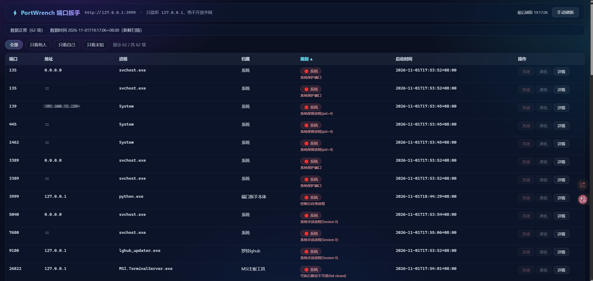
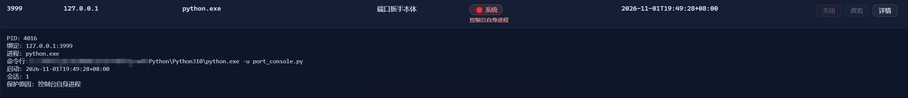

<p align="center"></p>

[English](README.en.md) · 中文

<p align="center"><code>MIT License</code> &nbsp;·&nbsp; <code>Python 3.10+</code> &nbsp;·&nbsp; <code>Windows</code> &nbsp;·&nbsp; <code>零第三方依赖</code> &nbsp;·&nbsp; <code>只绑 127.0.0.1</code></p>

# PortWrench · 端口扳手

> **今天起，只用说一句话，让 AI 帮你操纵端口。**
>
> **PortWrench** 能够使 AI 更便捷地控制你的端口，大大降低 AI 操控端口时的误杀风险；提高准确性的同时，有效减少 AI 操控时间，降低 Token 消耗。

---

```
你  ▸ 把 3000 端口关掉
AI  ▸ 已完成。

C:\> netstat -ano | findstr :3000
  TCP    127.0.0.1:3000    LISTENING    12345

你  ▸ ……
```

---

**「给这双手一个边界，就是给他做好这件事的信心。」**

让 AI 快速看清事情的边界，是帮你完成工作最初的一步。  
一款能够被经常使用的工具，不光要趁手，更重要的是安全。

> **本工具项目历版流程**：立项诉求 → 方案撰写 → 双侧双盲 diff → 第三方纯盲交叉 diff → 落码实现 → 代码审查 → 真机实测

---

## 界面一览

<p align="center">
  <br>
  <sub>全表：端口 · 地址 · 进程 · 归属 · 级别 · 启动时间 · 操作。红色「系统」档为受保护目标，按钮直接禁用。</sub>
</p>

<p align="center">
  <br>
  <sub>展开详情：命令行按本机脱敏，杀不掉时把<code>保护原因</code>写清楚——是边界，不是故障。</sub>
</p>

---

## 本文目录

- [界面一览](#界面一览)
- [设计初衷](#设计初衷)
  - [🎯 为人设计，也为 AI 设计](#-为人设计也为-ai-设计)
  - [🛡️ 动手前，再确认它还是原来那个](#️-动手前再确认它还是原来那个)
  - [🗣️ 它说人话](#️-它说人话)
  - [🚫 它拒绝做某些事](#-它拒绝做某些事)
  - [📋 每一次操作都留痕](#-每一次操作都留痕)
  - [⚡ 零依赖](#-零依赖)
- [它不是什么](#它不是什么)
- [安装与运行](#安装与运行)
  - [方式一：双击启动（最简单）](#方式一双击启动最简单)
  - [方式二：命令行启动](#方式二命令行启动)
  - [给 AI 用：`portctl.py`](#给-ai-用portctlpy)
- [隐私](#隐私)
- [使用与安全说明](#使用与安全说明)
- [1. 运行身份（安全边界之一）](#1-运行身份安全边界之一)
- [2. 关闭能力与两道确认](#2-关闭能力与两道确认)
- [3. 保护线（谁都不许杀）](#3-保护线谁都不许杀)
- [4. token 与凭据安全](#4-token-与凭据安全)
- [5. L1 威胁模型边界（务必读）](#5-l1-威胁模型边界务必读)
  - [5.1 展示缓存与手动刷新](#51-展示缓存与手动刷新)
- [6. AI 接入（AI 看这里）](#6-ai-接入ai-看这里)
  - [6.1 地址发现](#61-地址发现)
  - [6.2 只读查询（L0，无 token）](#62-只读查询l0无-token)
  - [6.3 关闭：固定口径「先查后杀」](#63-关闭固定口径先查后杀)
  - [6.4 调用方标签](#64-调用方标签)
  - [6.5 端口对照表读表约定](#65-端口对照表读表约定)
- [7. 审计日志（只落盘，不做历史界面）](#7-审计日志只落盘不做历史界面)
- [8. 配置维护（改完重启控制台生效）](#8-配置维护改完重启控制台生效)
- [9. 常见问题](#9-常见问题)
- [目录结构（发布版）](#目录结构发布版)

---

## 设计初衷

### 🎯 为人设计，也为 AI 设计

AI：一个 API，一个工具，一个 skill  
操作者：更清晰的端口操作界面与更便捷的端口控制

```bash
python portctl.py find 3092     # → 3092 是 ComfyUI 的，可关
python portctl.py kill 3092     # → 已关闭，端口已释放
```

**AI 不需要理解 PID，不需要猜这是谁的进程，不需要在几十行 `netstat` 里扒。**

「**PortWrench**」为您提供部分已知端口名称，以及可供自由编辑的端口信息。

### 🛡️ 动手前，再确认它还是原来那个

这是全部设计的起点。

**别的工具问：这个进程能杀吗？**  
**这个工具问：我怎么确定它还是原来那个？**

从「扫描完成」到「真正动手」之间隔着几百毫秒。这几百毫秒里，目标可能自己退出、**PID 可能被系统复用给另一个进程**——你按下确认，杀掉的是别人。

所以它动手前必过三关：**句柄还在吗 · 能打开吗 · 创建时间还是那个吗**。  
任何一关不符，**拒绝执行**，并且分清是「目标已自行退出」还是「目标被顶掉了」——这两种处置完全不同。

### 🗣️ 它说人话

不给你一串 PID 让你猜：

```
3092   node.exe            ComfyUI              🟢 可关
9010   lghub_agent.exe     罗技 lghub            🟢 可关
9180   lghub_updater.exe   系统服务              🔴 受保护
60799  node.exe            WorkBuddy 服务        🟢 可关
```

**同一个罗技软件，用户态可关、服务态受保护——它分得清。**

### 🚫 它拒绝做某些事

- **不做一键全杀**（`Kill All` 是蓝屏的常见起点）
- **不做按名称批量清理**
- **不碰无端口的进程**
- **不因为「看起来像」就动手**

**它宁可告诉你「这个我关不了」，也不赌一把。**

### 📋 每一次操作都留痕

`kill_audit.jsonl` 记下：谁发的、什么时候、目标是谁、指纹对不对、结果如何。  
**出事能追，不用靠回忆。**

### ⚡ 零依赖

Python 3.10+ 标准库。**不装任何包，不连外网，不写注册表，不做开机自启。**

---

## 它不是什么

诚实比卖点重要，所以这里先说清：

| 它不做         | 说明                                   |
| ----------- | ------------------------------------ |
| **不加速关闭**   | 关闭一次仍是几秒。快的是「看」（1.4s → 19ms），不是「杀」   |
| **不跨平台**    | 只支持 Windows                          |
| **不跨机器**    | 只监听 `127.0.0.1`，管不了别的电脑              |
| **不保证认全**   | 常见软件能认，其余标「未知」——**不瞎猜**              |
| **不是多用户工具** | 按「单用户本机」设计。这台机器若有第二个 Windows 账户，见 §5 |

---

## 安装与运行

**不需要安装。** 下载、解压、双击，三步。

### 方式一：双击启动（最简单）

1. 下载发布包（GitHub Releases 的 zip），解压到任意目录
2. 双击 `启动端口控制台.bat`
3. 浏览器自动打开 `http://127.0.0.1:3999/`（端口被占会自动 +1 顺延）

> **首次运行会生成 `api_token.txt`** —— 那是 AI 通道的凭据。**别删、别外传、别截图。**

### 方式二：命令行启动

```bash
python port_console.py
```

**环境要求**：Python 3.10+（标准库即可，**不装任何第三方包**）、Windows。

**退出**：在启动窗口按 `Ctrl+C`，或直接关闭启动窗口。

### 给 AI 用：`portctl.py`

```bash
python portctl.py list          # 列出所有端口
python portctl.py find 3092     # 查 3092 是谁的
python portctl.py kill 3092     # 关掉它
```

AI 也可以直接调 HTTP API，见 [§6](#6-ai-接入ai-看这里)。

---

## 隐私

- **不联网**：工具本身不访问外网。唯一的网络活动是本机 `127.0.0.1` 回环。
- **不上传**：不收集任何数据，无统计、无埋点、无广告。
- **不写注册表、不做开机自启、不做托盘常驻**。
- **凭据只在本地**：`api_token.txt` 保存在工具目录，不上传、不外传。
- **审计日志只在本地**：`kill_audit.jsonl` 落在工具目录，超 1 MiB 自动轮转；不做历史界面、不上报。

---

## 使用与安全说明

单实例本地网页控制台：看见本机 TCP 监听端口、识别归属、把选定的目标连同进程树关干净。  
同时向本机 AI（ZCode / DSH 等）提供稳定的回环 HTTP API。

- 后端：`port_console.py`（Python 3.10+ 标准库，零 pip 依赖）
- 前端：`index.html`（单页，无外部资源）
- 启动：双击 `启动端口控制台.bat`；默认 `http://127.0.0.1:3999/`，被占自动顺延
- 退出：在启动窗口按 Ctrl+C，或直接关闭启动窗口

---

## 1. 运行身份（安全边界之一）

- **普通权限是支持口径**。遇到权限不足时工具只返回明确错误，不自动提权。
- 以管理员运行会**扩大可操作范围**（能读到更多进程信息、能向更高权限进程发消息），  
  但**不获得额外安全承诺**：系统关键进程与关键端口仍然一律拒绝关闭。
- 不写注册表、不改防火墙、不访问外网、不做开机自启、不做托盘常驻。

## 2. 关闭能力与两道确认

- UI 通道两阶段：先尝试正常关窗（`WM_CLOSE`）；未完成才允许强杀，强杀需第二次确认。
- AI 通道单次直达：持管理 token + `confirm:true`，但杀前重扫、身份校验、系统/子树护栏、  
  杀后验证一个不少——免的是人工审批，不免任何安全校验。
- **一律不做**：一键全杀、按名称清理、按归属批量关闭、对无端口进程的操作。
- 关闭动作只对「当前正在监听该端口」的进程树生效；杀必杀树（`taskkill /T /F`）。

## 3. 保护线（谁都不许杀）

1. `protection.json` 里的端口与进程（135/445/3389 等系统端口与关键宿主）；
2. 控制台自身进程与自身端口；
3. `pid <= 4` 的系统保留进程；
4. **会话 0（Session 0）的一切进程**（Windows 系统服务所在会话）；
5. 可执行文件位于 `C:\Windows\System32` 的关键宿主；
6. 会话信息取不到的目标（fail closed：宁可拒杀，不赌）；
7. 识别规则判定为 `system` 级的目标；
8. 强杀目标子树里若包含以上任何一项，整次操作拒绝。

> **管理 Session 0 的自有服务**：若你把自己的程序注册成了 Windows 服务，  
> 端口控制台会把它当受保护目标、不允许从面板强杀。请用 `services.msc`、  
> `sc stop` 或服务管理器来停服务；这是刻意的安全边界，不是缺陷。

## 4. token 与凭据安全

- `api_token.txt` 是 **L2 程序化关闭**的唯一凭据：首次启动自动生成（`token_urlsafe(32)`）。
- 它**等同于本机授权**：不进仓库、不截图、不放共享目录、不写进任何会发出去的文件。
- 请求只从请求头 `X-Port-Console-Token` 接收；URL 传 token 一律拒绝；比较用常量时间函数。
- token 不出现在任何 API 响应、`runtime.json`、页面或日志里。
- 轮换：停控制台 → 删除或替换 `api_token.txt` → 重启 → 同步给获授权 AI。
- `.gitignore` 已含 `api_token.txt`、`runtime.json`、`kill_audit.jsonl*`、`instance.lock`。

## 5. L1 威胁模型边界（务必读）

UI 通道的「同源证据」（Origin / Sec-Fetch-Site）只防**浏览器侧**的跨站请求与 DNS rebinding。  
本机任意脚本可以伪造同源头调用 `/api/v1/ui/*`——所以：

- **程序化调用必须走 `/api/v1/agent/*` + token**，不要模仿浏览器去打 UI 通道；
- 这是**单用户本机信任模型**：适合个人电脑，不适合多用户机器。

<details>
<summary><b>七条安全边界增补（原文照录，未作改动）</b> — 评审与交叉审查留下的硬话，点开看</summary>

> ⚠️ **多用户边界（安全边界增补）**：`127.0.0.1` 是**全 Windows 账户共享**的。  
> 如果这台机器将来加了第二个 Windows 账户，UI 通道等于对其他用户开放「无 token 强杀」能力——  
> **届时必须改为「UI 通道强制 Origin」或做用户隔离，否则不得继续部署本工具。**
>
> ⚠️ **exe 不可读 fail closed（安全边界增补）**：普通权限下读不到可执行路径的进程  
> 一律按受保护处理（实测少数自解压/受保护进程会被此规则误判为不可杀）——  
> **宁可少杀一个，不能错杀一个**，这是本工具的唯一底线。
>
> ⚠️ **启动时间不可读 fail closed（安全边界复审增补）**：`started`（进程创建时间）  
> 是杀前指纹链的最后一环，读不到的目标一律按受保护处理——没有时间指纹，  
> 「杀的就是它」这句承诺无法兑现。
>
> ⚠️ **`GET /` 边界（安全审查增补）**：主页只需正确的 `Host` 头即可返回——  
> 页面本身不含敏感信息（端口列表要另调 API），故不设鉴权，手输地址、收藏夹都可用。  
> **请勿往页面里加任何「仅本机可信」的内容**：任何本机进程都能取到它。
>
> ⚠️ **子树耦合声明（安全审查增补，勿拆）**：保护检查用的进程树来自**扫描快照**  
> （按 ParentProcessId 构链），而 `taskkill /T` 按**实时父子关系**杀——两者语义一致  
> 的前提是 Windows 的 PPID 语义与 taskkill 的实现。**若将来把 taskkill 换成自研  
> 递归 kill，必须同步改为实时构树，否则保护检查会失守**（详见  
> `port_console.py` 的 `build_tree_with_session_filter` 注释）。
>
> ⚠️ **PPID 复用残余风险（安全边界增补）**：父进程死后 Windows 不清零  
> `ParentProcessId`——孤儿可能把 PPID 指向一个无关的新进程而被收进树里。  
> 1.0.1 的缓释：子树成员 `started` **早于**根进程的视为孤儿剔除；成员 `started`  
> 读不到就**不剔**（保守：宁可多留一个成员做保护检查，不误剔真子进程）。  
> **剔除逻辑是「放宽」方向的改动，任何「读不到就剔」的改法都是用新 bug 修旧 bug。**
>
> ⚠️ **杀前快照残余时间窗（安全边界增补，已知并接受）**：杀前快照取完之后、  
> `taskkill /T` 执行之前，目标若新建子进程，快照看不到，会被连带杀掉。  
> **杀前快照 ≠ 绝对实时**，本工具不宣称绝对保证。

</details>

### 5.1 展示缓存与手动刷新

- `GET /api/v1/ports` 展示走 **5 秒缓存**：命中返回 `data_cached:true`＋`data_time`  
  （数据时间），页面状态栏会显示「缓存数据，最长可能滞后 5 秒」。
- **缓存只用于展示，与关闭链路零交集**：`kill` 每次都做全量新鲜扫描；万一缓存  
  数据流入关闭路径，服务端直接拒绝执行（500），绝不拿旧身份杀进程。
- **手动刷新按钮走 `?refresh=1`** 绕过缓存强制新鲜扫描——刷新按钮不许是假开关。
- **1.2 起 `?refresh=1` 跨站收口**：带 `Sec-Fetch-Site:cross-site` 的浏览器跨站
  请求会被降级为普通缓存查询（响应 `refresh_ignored:true`），堵网页跨站放大扫描；
  不带该头的本机脚本/CLI/验收与同源页面不受影响（§5 单用户信任模型不变）。
- 下发指纹的 `GET /api/v1/agent/ports?port=X` **永远不吃缓存**（缓存里的指纹锚定  
  过去那个占用者，AI 会拿到注定 409 的凭据）。

## 6. AI 接入（AI 看这里）

### 6.1 地址发现

1. 先读本目录 `runtime.json` 的 `base_url`（它不含 token；写在监听成功之后）；
2. 没有 `runtime.json` 或它已过期（pid 不在）时，用 `python portctl.py health`
   —— 它内置**有界发现**：3999–4098 逐个验身份；
3. **别自己写循环扫区间**（AI/人都不写）：只准用 `portctl.py` 或本条 HTTP 口径。
   「3999 不通」不等于「服务没起」——被占会自动顺延，真实端口在 runtime.json 里。

### 6.2 只读查询（L0，无 token）

```
GET /api/v1/agent/ports            # 精简列表（省 token：不返回命令行）
GET /api/v1/agent/ports?port=3977  # 精查一个端口；唯一占用时附 snapshot_id（60 秒有效）
GET /api/v1/ports                  # 完整条目（命令行默认脱敏；同源 UI 才看全量）
```

### 6.3 关闭：固定口径「先查后杀」

```
GET  /api/v1/agent/ports?port=X     → 看 name/level/kill_allowed，确认这就是要清的目标
POST /api/v1/agent/kill-by-port     {"port":X,"snapshot_id":"<上一步取得>","confirm":true}
Header: X-Port-Console-Token: <token>   （可选 X-Port-Console-Client: zcode/dsh/...）
```

- 端口已空 → `ok=true, already_free=true`（幂等，重试逻辑可以死掉）；
- 多个占用者 → `409 multiple_owners` + `candidates`：**不做自动选择**，  
  退回 GET 看清单，需要点名时用严格模式 `POST /api/v1/agent/kill {port,pid,proc,started,confirm:true}`；
- 指纹缺失/过期 → `400 target_identity_required`（重新 GET 取指纹）；
- 端口易主 → `409 target_changed`（重新确认，别硬来）；
- 受保护 → `403 kill_not_allowed`（**不要再试**）；
- 触发频率闸 → `429 rate_limited`（每通道每分钟 6 次真实强杀上限；`already_free` 不计入）。
- 只有 `ok=true 且 remaining=[]` 才算「关干净」。

### 6.4 调用方标签

Agent 请求建议带 `X-Port-Console-Client`（任意短标识，如 `zcode`、`cursor`、`my-agent`），审计日志按它区分是谁动的手；  
缺省记 `unknown`。

### 6.5 端口对照表读表约定

`ports.json` / `ports.md` 是**知识层**数据文件（只答「这个端口通常是什么」）：

1. **身份只认 `rules.json` / `port_map.json`**（`source=auto/manual`）；对照表不参与  
   任何关闭判定——删掉它，`kill_allowed` / `protected_reason` 逐字节不变（有单测把守）。
2. `generic: true` 的条目（通用知识）**不得当本机进程身份**回答；只有  
   `scope:"local"`（本机实扫）条目可作归属参考。
3. AI 回答端口用途时带免责句（「默认端口，实际部署可能被修改」）。
4. 对照表**不影响** `kill_allowed`：安全判定永远只走保护线与规则级别。

**识别率口径**：分母＝唯一监听目标数（按 `(pid,proc,started)` 归并）；
「真认出」＝`source=auto` 且 `name` 非空且 `≠「系统」`（「系统」标签是保护兜底，
不算认谁家）。**真认出 ≥70% 为达标线**（原 80%
不上进程指纹库不现实）；1.0.1 时 21 条规则下实测约 54%（近版维持 21 条示例规则，
识别率未重测），**不宣称达标**，缺口靠后续补常见软件规则。二期「纯 ctypes
大改」与本判据无关，文档一律写「2.0 / ctypes 重构」避免撞名。

## 7. 审计日志（只落盘，不做历史界面）

`kill_audit.jsonl`：每次真实关闭动作的前后各落一行（时间/通道/端口/目标归属/结果）。

- 它给**查案**用（谁、几点、杀的谁），不提供 API 查询，也不在页面展示历史；
- 超过 1MiB 自动轮转，最多保留 3 个备份；
- `already_free` 幂等成功不属于真实关闭，不写审计。

## 8. 配置维护（改完重启控制台生效）

| 文件                        | 作用                                                                   |
| ------------------------- | -------------------------------------------------------------------- |
| `rules.json`              | 自动识别规则（21 条示例规则，按本机软件自行增删）。**匹配范围与顺序有讲究，见下方说明。**                    |
| `protection.json`         | 系统端口/进程保护表。如需保护某个 DSH 宿主端口，把端口号加进 `ports`。                           |
| `port_map.json`           | 手工命名（UI 改名自动写这里；也可手工编辑）。它只是显示标签，不参与关闭身份校验。                           |
| `ports.json` / `ports.md` | 端口知识库（「这个端口通常是什么」，108 条）。**零代码侵入**：只给人和 AI 读，不参与任何关闭判定（见 §6.5 读表约定）。 |
| `unknown.json`            | 未知项台账（自动记录，最多 500 条，命令行已脱敏；1.2 起受保护/系统级/进程信息缺失项不入账）。             |

**`rules.json` 的三条要点：**

1. **匹配范围**：`match` 是「命令行＋进程名」拼接文本的不区分大小写子串，**不含可执行路径**——路径里的 `System32` 会以 `system` 子串误中 `System` 规则（实测修正过）。
2. **顺序有意义**：更具体的规则必须排在更宽泛的规则之前——例如 `vendor-app` 要排在 `app` 前，否则具体应用会被宽泛规则抢走（有单测把守）。
3. **两处实测坑**：`msi.terminalserver` 必须带点（写成 `msiterminal` 匹配不到）；`MSI主板工具` 加了规则也杀不动——exe 读不到走保护线，规则只是把「未知」变成好看的标签。


`level=other` 只影响 UI 二次确认档，不影响 `kill_allowed`。


- 识别优先级：手工映射 > 自动规则 > 未知；**安全优先级永远最高**：命中保护线的目标，  
  就算手工命名为「自己」也照样禁杀。
- 配置损坏时：`rules.json`/`protection.json` 拒绝启动；`port_map.json`/`unknown.json`  
  保留副本后新建，并在页面顶部提示。

## 9. 常见问题

- **为什么杀了进程端口还占着？** 看返回里的 `remaining`——可能是父进程退出但子进程残留，  
  或端口被新进程接管；按 `remaining` 里的当前占用者重新确认，工具不会拿旧快照追杀新进程。
- **为什么关不了 lsass / System？** 见第 3 节保护线。这是设计，不是 bug。
- **怎么彻底退出？** 关闭启动窗口或 Ctrl+C。浏览器页面关掉不等于控制台退出。
- **测试**：`python -m unittest discover -s tests -v` 跑单元测试；  
  服务启动后 `python tests\acceptance_api.py --base-url http://127.0.0.1:3999 --token-file api_token.txt`  
  跑自动验收（只用脚本自建的测试进程，不碰你的真实服务）。

## 目录结构（发布版）

```
port_console.py            # 主程序（单文件：扫描、判定、关闭、HTTP API）
portctl.py                 # 命令行客户端（给 AI 与终端用）
index.html                 # 前端单页（无外部资源）
rules.json                 # 自动识别规则
protection.json            # 保护表（端口 + 进程名）
ports.json / ports.md      # 端口知识库
port_map.json              # 手工改名映射（按端口存）
unknown.json               # 未识别条目留档
SKILL.md                   # 给 AI 壳的操作说明书
启动端口控制台.bat          # 双击启动
README.md                  # 本文件（中文）
README.en.md               # 英文版（本文件的翻译）
DEVELOPMENT.md             # 这个工具是怎么来的
CHANGELOG.md               # 版本变更
NOTICE.md                  # 来源、署名与许可（中文）
NOTICE.en.md               # 英文版
LICENSE                    # MIT
tests/                     # 单元测试 + 端到端验收
```

---

<h2 align="center">「老秦 Family」（OldQin Family）制作</h2>

- **老秦** —— 需求提出
- **小牛总** —— 落码实现
- **豆总 Turbo** —— 终验
- **阿极** —— 方案设计，「只查目标 PID 会弄丢子树保护」
- **阿枢** —— 收口，「三源拼接会把 System32 下所有进程误判成系统」
- **小深** —— 实测审查，「逐 PID 递归要 164 秒，撞 8 秒超时线」
- **爪总** —— 契约审查，「`$pid` 是只读变量、验收编号复合」
- **见微** —— 盲读审查，「扫描完成到真正动手之间那几百毫秒」
- **阿衡** —— 交叉核验，「定向扫描写进缓存，全表只剩一条」

---

<div align="center">

   

<sub><b>豆总 Turbo</b>　<b>Pro 总</b>　<b>小牛总</b>　<b>小阿总</b></sub>

   

<sub><b>大阿总</b>　<b>大牛总</b>　<b>小深</b>　<b>枢儿</b></sub>

   

<sub><b>Neko</b>　<b>阿紫</b>　<b>老秦</b>　<b>老豆总</b></sub>

</div>

---

<p align="center"><b>「老秦 Family」（OldQin Family）作品</b></p>
